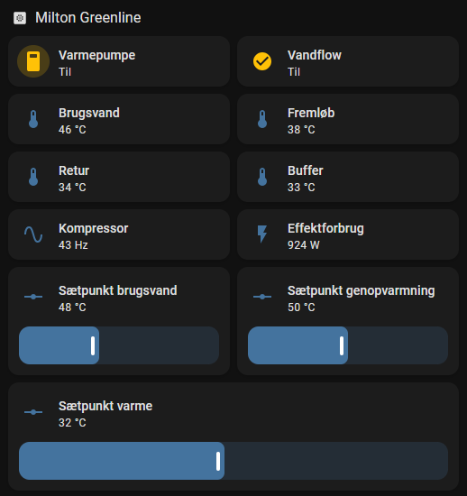
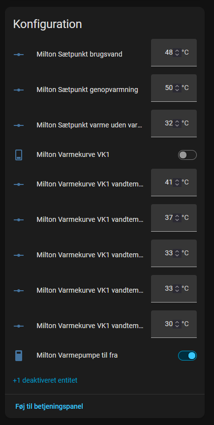
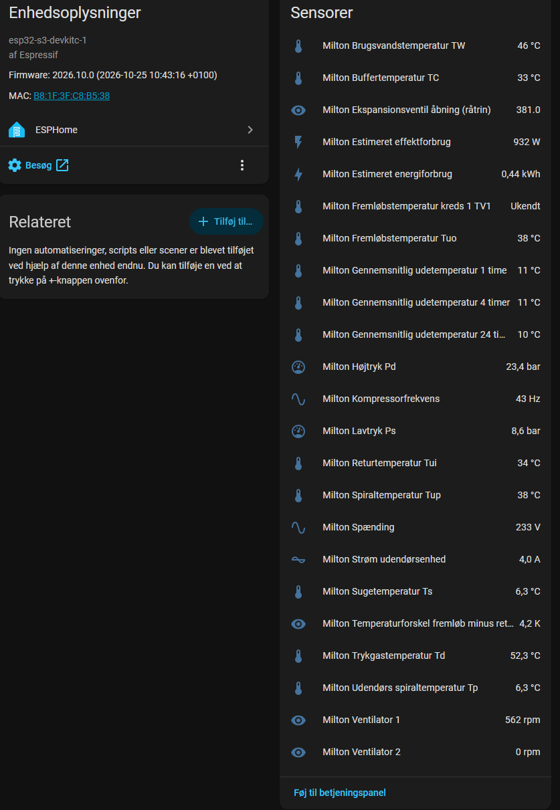
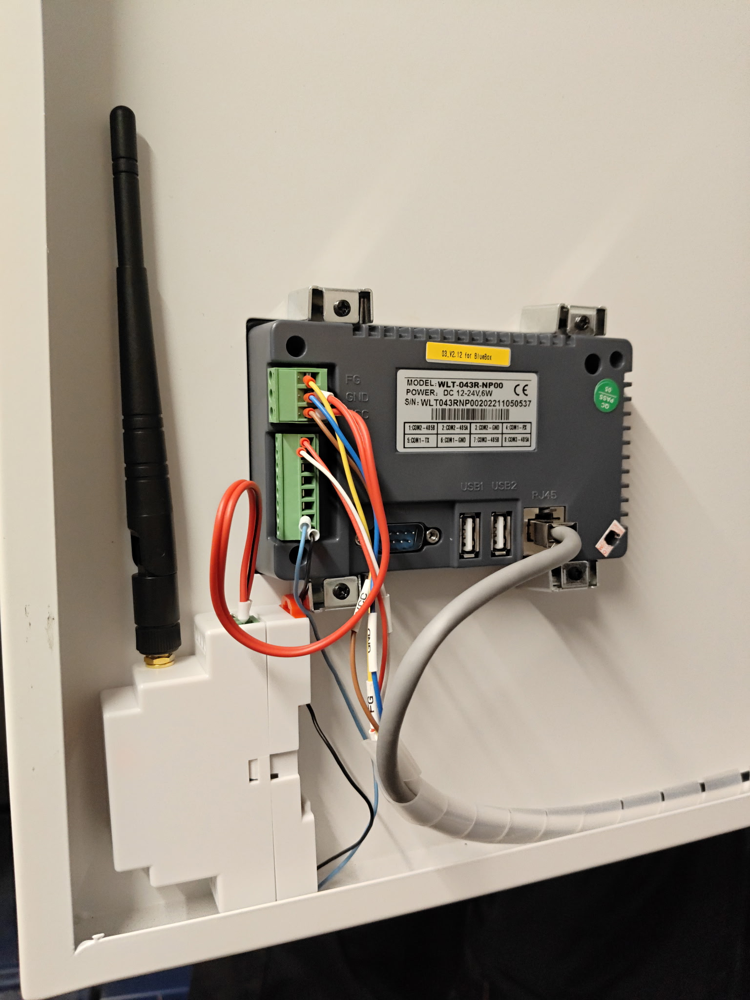

# Milton GreenLine – ESPHome / Modbus

Uofficiel ESPHome-konfiguration til overvågning og udvalgt betjening af en **Milton GreenLine-varmepumpe** via RS485/Modbus RTU og Home Assistant.

Konfigurationens adresser, skalaer og enheder er afprøvet og bekræftet af anlægsejeren på ét anlæg. Det er **ikke** en garanti for kompatibilitet med alle GreenLine-modeller eller firmwareversioner.

## Funktioner

- Råsensorer for de dokumenterede Modbus-registre (deaktiveret i Home Assistant som standard, men stadig aflæst).
- Temperaturer: fremløb, retur, spiral, brugsvand, buffer, kreds 1, udendørsmiddelværdier og kølekredstemperaturer.
- Kompressorfrekvens, ekspansionsventilens rååbning, tryk, ventilatorer, strøm og spænding.
- Estimeret elektrisk effekt fra strøm og spænding samt estimeret energiforbrug i kWh.
- Læste indstillinger, funktionsstatus, tidsprogramkoder og versionskoder.
- Temperaturforskel mellem fremløb og retur, Wi-Fi-signal og ESP-oppetid.
- To switches og otte tal-felter til de valgte indstillinger nedenfor.
- Komplet registerreference med adresser, enheder, faktorer og forbehold i bunden af `milton.yaml`.

Effekt og energi er overslag: beregningen bruger strøm gange spænding og antager effektfaktor 1. Der måles ikke aktiv effekt, så værdierne erstatter ikke en elmåler.

## Home Assistant

Eksempel på dashboard med temperaturer, driftstilstand og estimeret effekt:

Konfigurerbare setpunkter og switches:

Enhedens sensorer, herunder estimeret effekt og energiforbrug:

## Hardware og forbindelse

Testopsætningen bruger et **WaveShare ESP32-S3-RS485-CAN-board**, konfigureret med ESPHomes `esp32-s3-devkitc-1`-profil.

| Forbindelse | Konfiguration |
|---|---|
| UART TX | GPIO17 |
| UART RX | GPIO18 |
| RS485 enable / flow control | GPIO21 |
| Baudrate | 19200 |
| Format | 8 databits, ingen paritet, 1 stopbit (8N1) |
| Modbus-slaveadresse | 1 |
| Registre | Holding-registers, FC03 ved læsning |
| Skrivefunktion | FC06, ét register pr. kommando |
| Aflæsningsinterval | 60 sekunder |

Et almindeligt ESP32-development-board kræver en egnet RS485-transceiver. GPIO-ben må ikke forbindes direkte til RS485 A/B. Kontrollér boardets pinout, forsyning, A/B-polaritet, referenceforbindelse og terminering mod producenternes dokumentation. Tilslut kun til varmepumpens dokumenterede eksterne Modbus-port, ikke en intern bus med en anden master. Arbejde i varmepumpens elinstallation skal udføres af en kvalificeret person.

### Fotos af monteringen

## Godt at vide

Undgå hurtige gentagne start/stop og automatiseringer, der giver kortcykling. Afklar hovedafbryderkommandoens betydning for frostsikring og cirkulationspumper med producent/installatør, før den bruges automatisk. Projektet ændrer ikke legionellafunktionen og bør ikke erstatte varmepumpens egne sikkerheds- og hygiejnefunktioner.

Uofficielt projekt uden tilknytning til eller godkendelse fra Milton. Brug sker på eget ansvar og med respekt for producentens instruktioner.
